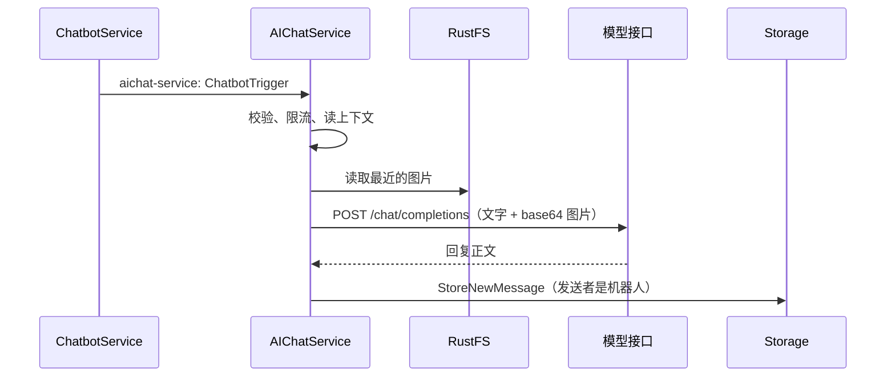

# AI 助手（AIChatService）

AI 助手是机器人平台上的内置机器人（用户 ID `900000000000000002`，账号 `betterfly_assistant`）。用户可以和它单聊，也可以把它拉进群，在群里 @它 或引用它的消息来提问；它能看懂文字和图片。分发规则、加好友与入群见 [机器人平台](CHATBOT.md)。

## 账号

AIChatService 启动时确保账号存在（显式 ID 插入、不推进 `users_id_seq`、密码为空），并在 `bots` 表登记为 Kafka 机器人，平台据此把触发转给 `aichat-service`。ID 必须在机器人段内，ID 或账号被其他用户占用时拒绝启动。修改昵称或头像后重启，客户端按资料同步刷新。

## 回复流程

1. 读取触发消息，确认它存在、未撤回、未超过 `AICHAT_MAX_TRIGGER_AGE`（默认 15 分钟）；群里确认触发里带了自己的 ID、机器人仍可发言。已回复过（`client_message_id = chatbot:<消息ID>:0`）时跳过。
2. 按用户限流：默认每分钟 6 次、每天 200 次（`AICHAT_TIMEZONE` 的自然日），超限时提醒一次。计数在进程内，多副本各自计数。
3. 上下文：
   - 单聊取双方最近 `AICHAT_CONTEXT_MESSAGES`（默认 20）条，群聊取主时间线最近 20 条，用户消息前加“昵称：”；
   - 总长度不超过 `AICHAT_CONTEXT_CHARS`（默认 6000 字），撤回的消息不进上下文，视频、文件等用“[视频]”这类占位符表示；
   - system 提示里带当前时间和群名。
4. 图片：上下文里最新的 `AICHAT_CONTEXT_IMAGES`（默认 3）张用户图片（含触发消息本身）从 RustFS 读取，转成 `data:` URL 作为 OpenAI 兼容的 `image_url` 内容发给模型，其余图片用“[图片]”表示。
   - JPEG、PNG 在 `AICHAT_IMAGE_MAX_SIDE`（默认 1568）像素和 4MB 以内原样发送；更大的图片和 GIF（取第一帧）、WebP 缩放后转为 JPEG；透明背景铺白。
   - 原图超过 `AICHAT_IMAGE_MAX_MB`（默认 20MB）或 4000 万像素时不读取。HEIC 暂不支持。
   - 有图片时使用 `AICHAT_VISION_MODEL`（为空时用 `AICHAT_MODEL`）。模型以 400/413/415/422 拒绝图片时，去掉图片重试一次。
5. 调用 `POST {AICHAT_API_BASE_URL}/chat/completions`，不使用流式输出；429、5xx 和网络错误按退避重试，遵守 `Retry-After`。
6. 去掉 `<think>` 段和控制字符，按段落、换行、句末拆成不超过 700 字的若干条，最多 `AICHAT_MAX_REPLY_PARTS`（默认 4）条。群里第一条回复引用被 @ 的消息。`client_message_id` 为 `chatbot:<触发消息ID>:<序号>`，重试不会重复。

特殊情况：

| 情况 | 回复 |
| --- | --- |
| 未配置模型地址或模型名 | “AI 助手还没有配置模型，暂时无法回答。” |
| 发来视频、文件等 | “我目前只能理解文字和图片消息。”（未开启识图时为“只能理解文字消息”） |
| 只发了一张读不了的图片 | “这张图片我暂时看不了，目前支持 JPEG、PNG、GIF 和 WebP。” |
| 模型重试后仍失败 | “抱歉，我暂时无法回答，请稍后再试。” |
| 模型返回空内容 | “我没有想好怎么回答，换个问法试试？” |

## 配置

| 变量 | 默认 | 说明 |
| --- | --- | --- |
| `AICHAT_API_BASE_URL` | 空 | 例如 `https://api.openai.com/v1`、`http://ollama:11434/v1`；Compose 兼容旧的 `CHATBOT_API_BASE_URL` |
| `AICHAT_API_KEY` | 空 | `Authorization: Bearer`；兼容 `CHATBOT_API_KEY` |
| `AICHAT_MODEL` | 空 | 模型名；兼容 `CHATBOT_MODEL` |
| `AICHAT_VISION_MODEL` | 空 | 带图片时使用的模型，为空时用 `AICHAT_MODEL` |
| `AICHAT_VISION` | `true` | 关闭后不读取图片 |
| `AICHAT_CONTEXT_IMAGES` | `3` | 0–10，`0` 关闭识图 |
| `AICHAT_IMAGE_MAX_MB` / `AICHAT_IMAGE_MAX_SIDE` | `20` / `1568` | 原图大小上限与发送时最长边 |
| `RUSTFS_ENDPOINT_URL` 等 | 见 Compose | 未配置时不识图，启动日志会提示 |
| `AICHAT_MAX_TOKENS` | `1024` | |
| `AICHAT_TEMPERATURE` | 不发送 | 0–2 |
| `AICHAT_REQUEST_TIMEOUT` / `AICHAT_LLM_MAX_RETRIES` | `60s` / `2` | |
| `AICHAT_SYSTEM_PROMPT` | 内置中文提示 | `{name}` 替换为昵称 |
| `AICHAT_CONTEXT_MESSAGES` / `AICHAT_CONTEXT_CHARS` | `20` / `6000` | |
| `AICHAT_MAX_REPLY_PARTS` | `4` | |
| `AICHAT_USER_RATE_PER_MINUTE` / `AICHAT_USER_DAILY_LIMIT` | `6` / `200` | `0` 表示不限 |
| `AICHAT_MAX_TRIGGER_AGE` | `15m` | |
| `AICHAT_USER_ID` / `AICHAT_ACCOUNT` / `AICHAT_NAME` / `AICHAT_AVATAR` | 见上 | 账号资料；ID 是客户端常量，各环境不要改 |
| `AICHAT_HTTP_PORT` | `8089` | 内网 `/healthz`、`/ready`、`/metrics` |
| `AICHAT_KAFKA_DLQ_TOPIC` | `aichat-service-dlq` | |

模型密钥写在 `services/.env`，不要提交。

## 运维

- 指标：`betterfly_aichat_triggers_total{result}`、`betterfly_aichat_llm_seconds{result}`、`betterfly_aichat_images_total{result}`（`ok`、`unsupported`、`too_large`、`missing`、`invalid`、`error`、`rejected`）。
- 日志不记录消息正文、图片与模型响应正文，模型接口错误只记录状态码。
- 图片按 base64 发送，单次请求可能有数 MB；按模型服务商的请求体上限调整 `AICHAT_CONTEXT_IMAGES` 和 `AICHAT_IMAGE_MAX_SIDE`。
- 同一分区内的触发串行处理，需要更高并发时增加 `aichat-service` 分区数。

## 客户端接入建议

协议不变，以下都是可选优化：

1. 入口：直接对 `900000000000000002` 发好友申请，自动通过后打开单聊；也可以搜索账号 `betterfly_assistant`。
2. 身份：显示“AI”徽标，隐藏通话按钮。
3. 群里 @：成员选择器列出机器人，选择后插入“@Betterfly 助手 ”。
4. 等待提示：发给机器人后显示“正在思考…”，收到下一条机器人消息或约 60 秒后消失。
5. 图片：iOS 拍照默认是 HEIC，上传前转成 JPEG 能让助手看懂。
