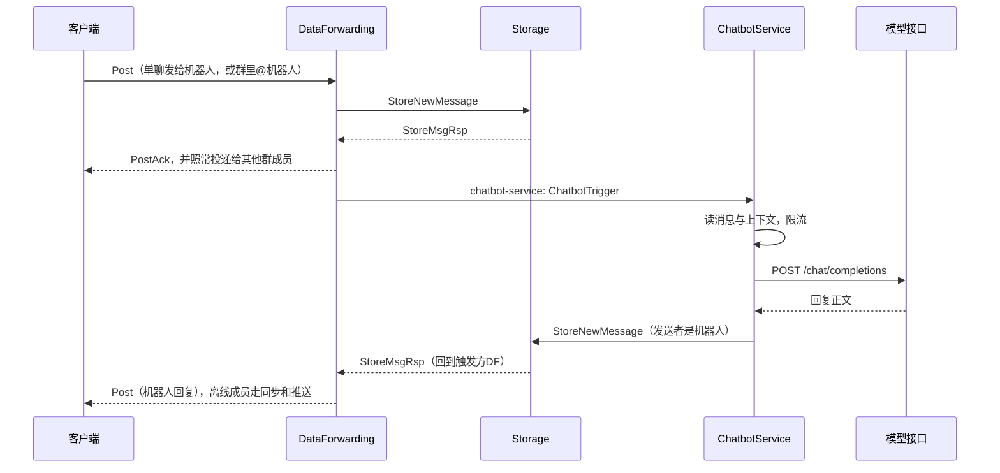

# AI 助手（ChatbotService）

AI 助手是一个由服务端托管的普通用户账号。用户可以和它单聊，也可以把它拉进群，在群里 @它 或回复它的消息来提问。它的回复和普通消息一样入库、多端同步、离线补收、推送，客户端不需要新协议。

## 一图看懂



## 机器人账号

| 项 | 默认值 | 说明 |
| --- | --- | --- |
| 用户 ID | `900000000000000002` | `CHATBOT_USER_ID`，DF 与 ChatbotService 必须一致 |
| 账号 | `betterfly_assistant` | `CHATBOT_ACCOUNT`，可被搜索 |
| 昵称 | `Betterfly 助手` | `CHATBOT_NAME`，也是群里 @ 的名字 |
| 头像 | 空 | `CHATBOT_AVATAR` |

ChatbotService 启动时在 `users` 表里确保这个账号存在：用显式 ID 插入、不推进 `users_id_seq`，密码哈希为空，因此无法登录。ID 已被其他账号占用或账号名被其他用户使用时服务拒绝启动。修改昵称或头像后重启服务，`update_time` 会变化，客户端按资料同步刷新。

## 触发规则

DataForwarding 在消息入库并完成投递后决定是否通知机器人：

- **单聊**：所有发给机器人的消息都触发。机器人没有 WebSocket 连接也没有推送设备，DF 不再为它查路由、发 APNs。
- **群聊**：机器人是成员，且消息满足以下全部条件：
  - 是文字消息、在群主时间线上（不是讨论串回复，也不是频道转发卡片），发送者不是机器人；
  - 正文包含“@昵称”（忽略空白和大小写，`@Betterfly 助手`、`@betterfly助手` 都算），或引用了机器人的一条消息。
- 机器人从群消息的投递与推送对象中移除。

触发消息按会话分区（单聊按用户，群按群 ID），同一会话的提问依次作答。

## 回复

1. 读取触发消息，确认它存在、未撤回、未超过 `CHATBOT_MAX_TRIGGER_AGE`（默认 15 分钟），群里确认机器人仍可发言。已有回复（`client_message_id = chatbot:<消息ID>:0`）时跳过。
2. 按用户限流：默认每分钟 6 次、每天 200 次（`CHATBOT_TIMEZONE` 的自然日）。超限时提醒一次，之后静默到窗口结束。计数在进程内，多副本各自计数。
3. 上下文：
   - 单聊取双方最近 `CHATBOT_CONTEXT_MESSAGES`（默认 20）条；
   - 群聊取主时间线最近 20 条，用户消息前加“昵称：”；
   - 总长度不超过 `CHATBOT_CONTEXT_CHARS`（默认 6000 字），撤回的消息不进上下文，图片等非文字消息用“[图片]”这类占位符表示。
   - system 提示里带当前时间和群名。
4. 调用 OpenAI 兼容接口 `POST {CHATBOT_API_BASE_URL}/chat/completions`，不使用流式输出。429、5xx 和网络错误按退避重试，并遵守 `Retry-After`。
5. 去掉推理模型的 `<think>` 段和控制字符，按段落、换行、句末拆成不超过 700 字的若干条，最多 `CHATBOT_MAX_REPLY_PARTS`（默认 4）条，超出部分截断并以“…”结尾。
6. 以机器人身份写入 Storage。群里第一条回复引用被 @ 的消息。`client_message_id` 为 `chatbot:<触发消息ID>:<序号>`，重试不会产生重复消息。

特殊情况：

| 情况 | 回复 |
| --- | --- |
| 未配置模型地址或模型名 | “AI 助手还没有配置模型，暂时无法回答。” |
| 单聊发来图片、文件等 | “我目前只能理解文字消息。” |
| 模型接口重试后仍失败 | “抱歉，我暂时无法回答，请稍后再试。” |
| 模型返回空内容 | “我没有想好怎么回答，换个问法试试？” |

服务关闭或 Kafka 重平衡中断时，触发消息留在 Kafka 里重试，不发送失败提示。

## 加好友与进群

- 好友：客户端照常发好友申请（`InsertContact`）。申请人所在的 DF 收到 FriendService 的创建回包后，以机器人身份发出同意，申请人随后收到 `RelationshipChangedEvent`（accepted）。重复提交申请会再次触发同意，可补上之前没接上的申请。
- 群：群主或管理员照常邀请（`InviteGroupMember`），DF 以同样方式代为接受邀请。权限与状态仍由 FriendService 校验。
- 机器人不会主动申请、退群或删除好友；用户删除好友、群管理员移除成员都照常生效，之后机器人不再收到触发。

## 配置

DataForwarding（`df`、`df2`）：

| 变量 | 默认 | 说明 |
| --- | --- | --- |
| `CHATBOT_USER_ID` | Compose 中为 `900000000000000002`；不设置时关闭 | 非法、等于 1 或等于 Monitor ID 时关闭 |
| `CHATBOT_NAME` | `Betterfly 助手` | 用于识别群里的 @ |
| `CHATBOT_TOPIC` | `chatbot-service` | 触发消息 topic |

ChatbotService：

| 变量 | 默认 | 说明 |
| --- | --- | --- |
| `CHATBOT_API_BASE_URL` | 空 | 例如 `https://api.openai.com/v1`、`https://api.deepseek.com/v1`、`http://ollama:11434/v1` |
| `CHATBOT_API_KEY` | 空 | 以 `Authorization: Bearer` 发送；本地模型可留空 |
| `CHATBOT_MODEL` | 空 | 模型名；与地址都配置后才调用模型 |
| `CHATBOT_MAX_TOKENS` | `1024` | 回复长度上限 |
| `CHATBOT_TEMPERATURE` | 不发送 | 0–2 |
| `CHATBOT_REQUEST_TIMEOUT` | `60s` | 单次请求超时 |
| `CHATBOT_LLM_MAX_RETRIES` | `2` | 0–5 |
| `CHATBOT_SYSTEM_PROMPT` | 内置中文提示 | `{name}` 替换为昵称 |
| `CHATBOT_TIMEZONE` | `Asia/Shanghai` | 提示中的当前时间与每日限额 |
| `CHATBOT_CONTEXT_MESSAGES` / `CHATBOT_CONTEXT_CHARS` | `20` / `6000` | 上下文条数与字数 |
| `CHATBOT_MAX_REPLY_PARTS` | `4` | 一次最多几条消息 |
| `CHATBOT_USER_RATE_PER_MINUTE` / `CHATBOT_USER_DAILY_LIMIT` | `6` / `200` | `0` 表示不限 |
| `CHATBOT_MAX_TRIGGER_AGE` | `15m` | 超过这个时间的提问不再回答 |
| `CHATBOT_ACCOUNT` / `CHATBOT_AVATAR` | 见上 | 账号资料 |
| `CHATBOT_HTTP_PORT` | `8088` | 内网 `/healthz`、`/ready`、`/metrics` |
| `CHATBOT_DB_MAX_OPEN_CONNS` | `4`（Compose） | 数据库连接预算 |
| `CHATBOT_KAFKA_DLQ_TOPIC` | `chatbot-service-dlq` | 无法解析的触发消息进入死信 |

`chatbot` profile 包含在 `standard`、`distributed`、`full` 预设中，也可以单独启用或重建：

```bash
cd services
./rebuild_docker_compose.sh --proto df-all chatbot
```

模型密钥写在 `services/.env`，不要提交。Kubernetes 基础清单暂不包含 ChatbotService；DF 未设置 `CHATBOT_USER_ID` 时行为与之前一致。

## 运维

- 指标：`betterfly_chatbot_triggers_total{result}`（`replied`、`llm_error`、`rate_limited`、`unconfigured`、`unsupported`、`empty`、`duplicate`、`stale`、`recalled`、`mismatch`、`not_member`、`self`），`betterfly_chatbot_llm_seconds{result}`。
- 日志不记录消息正文与模型响应正文，模型接口错误只记录状态码。
- 机器人回复的入库响应发往触发方 DF。该 DF 在此期间下线时，回复已入库，客户端通过同步拿到。
- 同一分区内的触发串行处理，一个慢请求会让同分区后续提问排队；需要更高并发时增加 `chatbot-service` 分区数。

## 客户端接入建议

协议不变，以下都是可选体验优化：

1. **入口**：在“添加好友”或会话列表提供“AI 助手”入口，直接对用户 ID `900000000000000002` 发好友申请，自动通过后打开单聊。也可以按账号 `betterfly_assistant` 搜索。
2. **身份标识**：用户 ID 等于 `900000000000000002` 时显示“AI”或“机器人”徽标；可以隐藏语音/视频通话按钮（机器人不会接听）。
3. **群里 @**：群成员选择器里列出机器人；选择后插入“@Betterfly 助手 ”。昵称以资料同步结果为准，服务端用实时昵称配置识别 @。
4. **等待提示**：单聊里发给机器人后可显示“正在思考…”，收到机器人的下一条消息或约 60 秒后消失。服务端不发送正在输入事件。
5. **长回复**：一次回复最多拆成 4 条连续消息，可以按普通消息展示。
