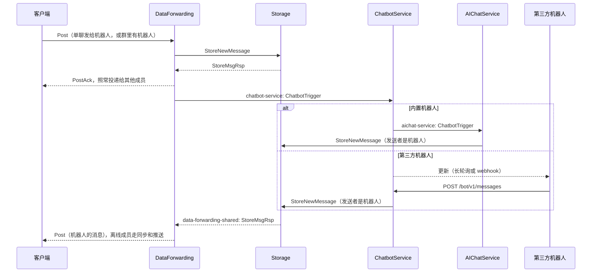

# 机器人平台（ChatbotService）

机器人是 `users` 表里 ID 落在机器人段的普通账号。用户照常加它好友、拉它进群、给它发消息；机器人发出的消息和普通消息一样入库、多端同步、离线补收、推送，客户端不需要新协议。

ChatbotService 负责把消息和关系变化分发给各个机器人，并为第三方机器人提供 HTTP Bot API。机器人分两类：

| 类型 | 投递方式 | 例子 |
| --- | --- | --- |
| 内置（`kafka`） | 触发消息原样转发到机器人自己的 Kafka topic | AI 助手，见 [AI 助手](AICHAT.md) |
| 第三方（`api`） | 写成“更新”，由机器人长轮询 `GET /bot/v1/updates` 或推送到它的 webhook | 天气、提醒、运维通知等任意服务 |

## 一图看懂



机器人发出的消息不属于任何连接，入库响应发往共享 topic `data-forwarding-shared`（`DF_SHARED_TOPIC`）。所有 DF 在同一个消费组里订阅它，每条响应只由一个 DF 投递。

## 机器人 ID

| 范围 | 用途 |
| --- | --- |
| `900000000000000001` | Monitor（不属于机器人段） |
| `900000000000000002` | AI 助手，客户端把它当常量 |
| `900000000000000003` – `900000000999999999` | 管理员创建的第三方机器人，依次分配 |

机器人账号用显式 ID 插入，不推进 `users_id_seq`；密码哈希为空，无法登录。DF 按 ID 段识别机器人（`CHATBOT_ENABLED=true`），不为它们查路由、发 APNs，入库回执与发给机器人的好友响应直接丢弃。

## 分发规则

DataForwarding 在消息入库并完成投递后通知平台：

- **单聊**：发给机器人的消息全部交给该机器人。
- **群聊**：群主时间线上、发送者不是机器人的消息，连同群里的机器人成员一起交给平台（讨论串回复和频道卡片不分发）。平台逐个判断：
  - 被 @：文字或图片说明里出现“@昵称”（忽略空白与大小写）或“@账号”；
  - 被引用：消息引用了这个机器人的消息；
  - 命令（只给第三方机器人）：消息以 `/命令` 开头时交给群里所有第三方机器人；`/命令@账号` 只交给对应账号。命令名由字母、数字和下划线组成，遇到其他字符即结束，`/weather上海` 的命令是 `/weather`，参数在 `text` 里。
  - 机器人停用或关闭了群聊（`allow_groups=false`）时不分发。
- 同一会话的消息按顺序进同一分区；第三方机器人的更新按 `update_id` 递增，同一条消息只写一次。

关系变化：

| 事件 | 处理 |
| --- | --- |
| 好友申请、群邀请 | 平台以机器人身份同意；机器人停用，或群邀请发给关闭群聊的机器人时拒绝。权限与状态仍由 FriendService 校验，重复提交可补上之前没接上的申请 |
| 申请被同意 | 第三方机器人收到 `friend_added` 或 `group_joined` |
| 用户删除机器人好友、机器人被移出群 | 第三方机器人收到 `friend_removed` 或 `group_removed` |

## 管理

设置 `CHATBOT_ADMIN_TOKEN`（至少 16 个字符）后开放管理页面和管理接口，请求头 `X-Admin-Token` 携带令牌。未设置时一律返回 404。管理页面经[统一网关](GATEWAY.md)访问 `https://<host>:54342/chatbot/admin/`，网关只对内网来源开放；服务本身同时在 `/admin/` 和 `/chatbot/admin/` 下提供页面与接口（下表的 `/admin` 前缀可换成 `/chatbot/admin`），直连 `8088/admin/` 时没有来源限制，对外暴露 8088 时应自行限制。

| 接口 | 说明 |
| --- | --- |
| `GET /admin/api/bots` | 列出全部机器人，包括 webhook 失败情况 |
| `POST /admin/api/bots` | `{"account","name","avatar"?,"description"?,"allow_groups"?}`，返回机器人与令牌。令牌只显示这一次 |
| `PATCH /admin/api/bots/{id}` | 修改 `name`、`avatar`、`description`、`allow_groups`、`disabled` |
| `POST /admin/api/bots/{id}/token` | 重置令牌，旧令牌立即失效；内置机器人没有令牌 |

账号只用小写字母、数字和下划线，3 到 50 个字符，不能与已有用户重复。头像是已校验文件的 `file_id`。修改名字或头像后客户端按资料同步拿到新值。

## Bot API

所有请求带 `Authorization: Bearer <token>`。响应统一为 `{"ok":true,"result":...}` 或 `{"ok":false,"error":{"code","message"}}`；503 带 `Retry-After`。

### 资料

- `GET /bot/v1/me`：`{id, account, name, avatar, description, allow_groups}`。
- `PATCH /bot/v1/me`：修改 `name`、`description`、`avatar`（自己上传过的 `file_id`，空串清除）。

### 接收更新

`GET /bot/v1/updates?offset=&limit=&timeout=`

- `offset`：确认 `update_id < offset` 的更新，之后不再返回；
- `limit`：1–100，默认 100；
- `timeout`：长轮询秒数，0 到 `CHATBOT_MAX_POLL_TIMEOUT`（默认 50）。

设置了 webhook 时返回 409。未取走的更新保留 `CHATBOT_UPDATE_RETENTION`（默认 24 小时）。

```json
{
  "update_id": 42,
  "message": {
    "message_id": 1001,
    "chat": {"id": 77, "type": "group", "title": "周末爬山"},
    "from": {"id": 12, "name": "Alice", "account": "alice"},
    "date": "2026-10-31T10:00:00+08:00",
    "type": "text",
    "text": "/weather@weather_bot 北京",
    "command": "/weather",
    "reply_to_message_id": 998
  }
}
```

- 单聊的 `chat.id` 是对方用户 ID，`chat.type` 为 `private`；群聊为群 ID 和 `group`。
- 图片、视频、语音、文件等消息带 `file: {file_id, file_name}`，图片说明在 `caption`，没有 `text`。
- 事件更新：`{"update_id":43,"event":{"type":"group_joined","user":{...},"chat":{...},"date":"..."}}`。

### Webhook

- `PUT /bot/v1/webhook`：`{"url":"https://...","secret":"..."}`；`GET` 查看状态与最近错误；`DELETE` 删除后回到长轮询。
- 平台按顺序 POST 每条更新（JSON 同上），2xx 视为送达。失败按 1、2、4…秒退避，最长 5 分钟；重新设置 webhook 立即重试。
- 设置了 secret 时带 `X-Betterfly-Bot-Timestamp` 和 `X-Betterfly-Bot-Signature: sha256=<hex>`，签名为 `HMAC-SHA256(secret, timestamp + "." + body)`。接收方应校验签名并拒绝时间戳过旧的请求。
- 默认只允许公网地址，注册时和连接时都会检查，不跟随重定向。内网部署可设 `CHATBOT_WEBHOOK_ALLOW_PRIVATE=true`。

### 发消息

`POST /bot/v1/messages`

```json
{"chat_id": 12, "chat_type": "private", "text": "北京明天晴", "reply_to_message_id": 1001, "client_message_id": "weather-20261031-1"}
```

- 文字：`text`，最长 700 字。
- 文件：`type` 为 `image`、`gif`、`video`、`audio`、`voice` 或 `file`（不填时为 `file`），`file_id` 来自上传接口，可选 `file_name`；只有图片可以带 `caption`。
- `reply_to_message_id` 必须是同一会话里的消息。
- 单聊只能发给已添加机器人为好友的用户；群聊需要开启群聊且机器人是可发言的成员。
- `client_message_id` 用于幂等，重试不会重复发送；不填时自动生成。
- 等待入库最多 `CHATBOT_SEND_WAIT`（默认 5 秒），成功返回 200 与 `message_id`；超时返回 202 `pending: true`，用同一 `client_message_id` 重试即可拿到结果。

### 文件

- `POST /bot/v1/files`：`multipart/form-data`，字段名 `file`，最大 `CHATBOT_MAX_UPLOAD_MB`（默认 50MB）。返回 `{file_id, file_name, size}`，`file_id` 为 `<SHA-512>.<后缀>`。
- `GET /bot/v1/files/{file_id}`：下载自己上传的文件，或会话里收到的文件。
- 文件存进 RustFS，与客户端上传的文件共用存储；需要配置 `RUSTFS_*`，否则返回 503 `files_disabled`。

### 最小示例

```bash
TOKEN=bfbot_xxx
curl -s -H "Authorization: Bearer $TOKEN" "http://localhost:8088/bot/v1/updates?timeout=30"
curl -s -H "Authorization: Bearer $TOKEN" -H 'Content-Type: application/json' \
  -d '{"chat_id":12,"chat_type":"private","text":"你好"}' http://localhost:8088/bot/v1/messages
```

## 配置

DataForwarding（`df`、`df2`）：

| 变量 | 默认 | 说明 |
| --- | --- | --- |
| `CHATBOT_ENABLED` | Compose 中为 `true` | 关闭时 DF 不识别机器人，行为与之前一致 |
| `CHATBOT_TOPIC` | `chatbot-service` | 触发与事件 topic |
| `DF_SHARED_TOPIC` | `data-forwarding-shared` | 机器人消息的入库响应 |

ChatbotService：

| 变量 | 默认 | 说明 |
| --- | --- | --- |
| `CHATBOT_ADMIN_TOKEN` | 空 | 管理令牌，为空时不开放 `/admin` |
| `CHATBOT_HTTP_PORT` | `8088` | Bot API、管理页面、`/healthz`、`/ready`、`/metrics`；Compose 映射到 `CHATBOT_PUBLIC_PORT` |
| `CHATBOT_UPDATE_RETENTION` | `24h` | 1h–30d |
| `CHATBOT_MAX_POLL_TIMEOUT` | `50s` | 长轮询上限 |
| `CHATBOT_SEND_WAIT` | `5s` | 发消息等待入库的时间 |
| `CHATBOT_WEBHOOK_TIMEOUT` | `10s` | 单次 webhook 请求超时 |
| `CHATBOT_WEBHOOK_ALLOW_PRIVATE` | `false` | 允许 webhook 指向内网 |
| `CHATBOT_MAX_UPLOAD_MB` | `50` | 上传上限 |
| `RUSTFS_ENDPOINT_URL` 等 | 见 Compose | 文件收发 |
| `KAFKA_STORAGE_TOPIC` / `KAFKA_FRIEND_TOPIC` | `storage-service` / `friend-service` | |
| `CHATBOT_DB_MAX_OPEN_CONNS` | `6`（Compose） | 数据库连接预算 |
| `CHATBOT_KAFKA_DLQ_TOPIC` | `chatbot-service-dlq` | 无法解析的消息进入死信 |

`chatbot` profile 包含 ChatbotService 与 AIChatService，属于 `standard`、`distributed`、`full` 预设：

```bash
cd services
./rebuild_docker_compose.sh --proto df-all chatbot
```

数据库迁移 v13 新增 `bots` 与 `bot_updates` 两张表，升级前须先跑迁移。Kubernetes 基础清单暂不包含这两个服务。

## 运维

- 指标：`betterfly_chatbot_routed_total{kind,result}`、`betterfly_chatbot_api_requests_total{route,status}`、`betterfly_chatbot_webhook_deliveries_total{result}`。
- 日志不记录消息正文与令牌。
- webhook 投递每次领取一个机器人并持有租约，多副本部署也不会乱序或并发投递给同一个机器人。长轮询的即时唤醒只在同一副本内生效，其他副本写入的更新最多晚 2 秒返回。
- 共享 topic 上 DF 从最新位置开始消费：DF 全部下线期间的机器人消息已入库，客户端通过同步拿到。

## 客户端接入

第三方机器人对客户端就是普通用户，不需要改动。可选优化：

1. 用户 ID 落在 `900000000000000002`–`900000000999999999` 时显示“机器人”徽标，隐藏语音/视频通话按钮。
2. 群里输入 `/` 时可以提示命令；`/命令@账号` 指定机器人。
