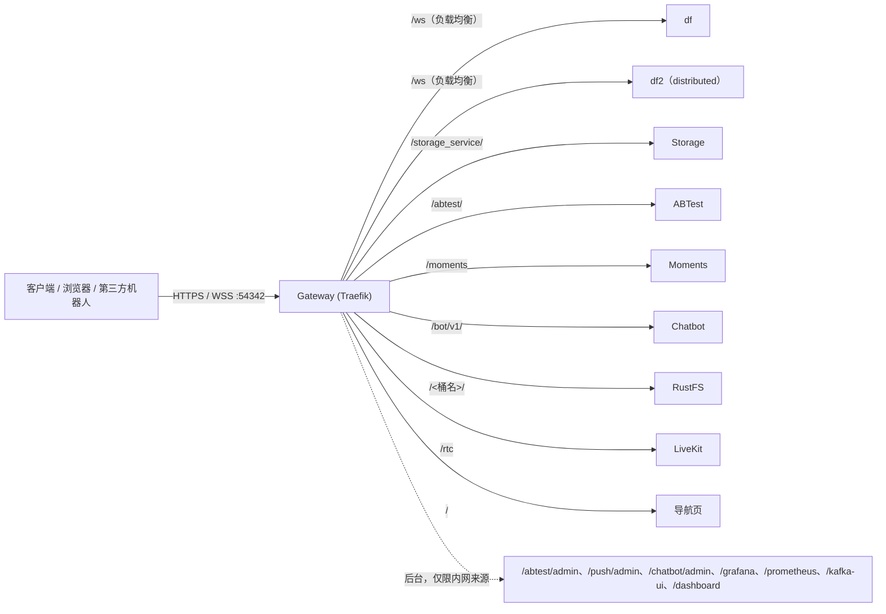

# 统一网关（Gateway）

所有对外的 HTTP、WebSocket 和后台页面都从网关的一个端口进入（默认 `https://<host>:54342`），网关按路径分发到各服务。根路径 `/` 是导航页，列出客户端接口、各管理后台和运维工具，并标出当前哪些路由在线。



网关使用 Traefik v3。路由写在各服务的 Compose `labels` 里，网关通过只读挂载的 Docker socket 发现；同名的路由和服务在多个容器上会合并成一个负载均衡，所以启动 `df2` 后 `/ws` 自动分流到两个实例，停掉后自动摘除。TLS、后台来源限制和 Traefik 自身的面板写在 [`services/gateway/dynamic/gateway.yml`](../services/gateway/dynamic/gateway.yml)。

## 路由

| 路径 | 后端 | 说明 |
| --- | --- | --- |
| `/` | portal | 导航页 |
| `/ws` | df、df2 | WebSocket，网关以 HTTPS 连接 DF 并做负载均衡 |
| `/storage_service/` | Storage | 文件控制面与资料接口 |
| `/abtest/` | ABTest | 实验配置获取 |
| `/moments` | Moments | 好友动态网页与 API |
| `/bot/v1/` | Chatbot | Bot API |
| `/<RUSTFS_BUCKET>/`、`/<MOMENTS_BUCKET>/` | RustFS S3 | 预签名 URL 的上传与下载（path-style） |
| `/rtc` | LiveKit | 群通话信令，见下文限制 |
| `/abtest/admin` | ABTest | 后台，仅限内网来源 |
| `/push/admin` | Push | 推送调试后台，仅限内网来源 |
| `/chatbot/admin/` | Chatbot | 机器人管理页面，仅限内网来源，另需 `CHATBOT_ADMIN_TOKEN` |
| `/grafana` | Grafana | `observability` profile，仅限内网来源 |
| `/prometheus` | Prometheus | `observability` profile，仅限内网来源 |
| `/kafka-ui` | Kafka UI | `tools` profile，仅限内网来源 |
| `/dashboard`、`/api` | Traefik 面板 | 查看路由与后端状态，仅限内网来源 |

后台路由挂了 `admin-only@file` 中间件，来源不在 `GATEWAY_ADMIN_SOURCE_RANGE` 内时返回 403。默认允许本机、私有网段和 IPv6 ULA；部署到公网时应收窄为自己的管理地址。各后台本身的令牌校验仍然有效，来源限制是额外的一层。

未启动的可选服务（如 df2、Grafana）没有对应容器，路由不会出现，访问时返回 404，导航页上显示为灰色。

## 预签名 URL 经网关

Storage 和 Moments 在 `RUSTFS_PUBLIC_VIA_GATEWAY=true`（Compose 默认）时，对经网关转发来的请求（带 `X-Forwarded-Proto`）按网关地址签发预签名 URL，例如 `https://<host>:54342/betterfly-files/...`；网关按桶名路径转给 RustFS，并原样透传 `Host`，所以签名照样有效。直连旧端口 8081、8087 的请求不受影响，仍然拿到 `http://<host>:9000` 的地址。显式配置了 `RUSTFS_EXTERNAL_ENDPOINT_URL` 时一律使用它。

Moments 的 `MOMENTS_PUBLIC_URL` 可以写逗号分隔的多个来源，默认同时允许直连的 `http://localhost:8087` 和网关的 `https://localhost:54342`。会话 Cookie 是否带 `Secure` 跟随请求所来自的来源。用域名或局域网地址访问时，需要把对应来源加进去。

## 端口

| 端口 | 绑定 | 用途 |
| --- | --- | --- |
| `54342` | 对外 | 网关，统一入口（`GATEWAY_PORT`） |
| `8081`、`8082`、`8087`、`8088`、`9000` | 对外 | Storage、ABTest、Moments、Bot API、RustFS 的旧端口，现有客户端和机器人仍在直连 |
| `7880-7882`、`3478`、`49160-49200/udp` | 对外 | LiveKit 与 Coturn 媒体，不经过网关 |
| `54341`、`54343` | 本机 | df、df2 直连（`DF_DIRECT_PORT`），供跨实例测试使用 |
| Redis、Kafka、Auth、Friend、Call、Push、RustFS 控制台、Prometheus、Grafana、Kafka UI | 本机 | 内部端口，绑定 `INTERNAL_BIND_ADDR`（默认 `127.0.0.1`） |

现有客户端连接 `wss://<host>:54342/ws`，现在由网关接收并转给 DF，证书与路径都没有变化，客户端不需要修改。旧端口在客户端全部改为经网关访问之前继续保留。

需要从其他机器访问内部端口时，把 `INTERNAL_BIND_ADDR` 设为 `0.0.0.0`，或者经 SSH 转发。

## 配置

| 变量 | 默认值 | 说明 |
| --- | --- | --- |
| `GATEWAY_PORT` | `54342` | 网关对外端口 |
| `GATEWAY_CERT_DIR` | `./dataForwardingService/certs` | 证书目录，需包含 `cert.pem` 与 `key.pem`；默认与 DF 共用自签名证书 |
| `GATEWAY_ADMIN_SOURCE_RANGE` | 本机、`10/8`、`172.16/12`、`192.168/16`、`fc00::/7` | 允许访问后台的来源，逗号分隔的 CIDR |
| `GATEWAY_LOG_LEVEL` | `INFO` | Traefik 日志级别 |
| `INTERNAL_BIND_ADDR` | `127.0.0.1` | 内部端口的绑定地址 |
| `DF_DIRECT_PORT` | `54341` | df 的本机直连端口 |
| `RUSTFS_PUBLIC_VIA_GATEWAY` | `true` | 经网关的请求按网关地址签发预签名 URL |
| `MOMENTS_PUBLIC_URL` | `http://localhost:8087,https://localhost:54342` | Moments 允许的来源列表 |

`gateway.yml` 由 Traefik 的文件 provider 读取并监视，修改后无需重启；`GATEWAY_ADMIN_SOURCE_RANGE` 通过模板读取，修改后需要重建 `gateway` 容器。

## 运维

```bash
cd services
./rebuild_docker_compose.sh gw        # 重建 gateway 与 portal
docker logs gateway
```

- 网关的指标在容器内 `:8080/metrics`，Prometheus 的 `gateway` 任务抓取它。
- 网关对外的读写不设超时（WebSocket、Bot API 长轮询、大文件上传），空闲连接 180 秒关闭。
- DF 的证书没有 SAN，网关连接 DF 时不校验证书（`betterfly-internal-tls`），只用于容器网络内部。
- 从旧版本升级时，df 原先占用宿主机 54342，需要重新创建整个栈（`docker compose up -d`），让网关接管这个端口。

### LiveKit

`/rtc` 把群通话信令转给 LiveKit，但 LiveKit SDK 要求受信任的证书，自签名证书下不能用；媒体（UDP 7882）也始终直连。使用正式证书之前，`LIVEKIT_URL` 保持直连地址。

### 镜像

Compose 使用 `traefik:v3.7.15`。无法访问 Docker Hub 时，可以用官方 GitHub Release 中的 `traefik_v3.7.15_linux_<arch>.tar.gz`（按同版本的 `checksums.txt` 校验）在本地构建一个同名镜像，只需包含 `traefik` 二进制和 CA 证书，入口为 `/traefik`。网络恢复后执行 `docker pull traefik:v3.7.15` 覆盖即可。
